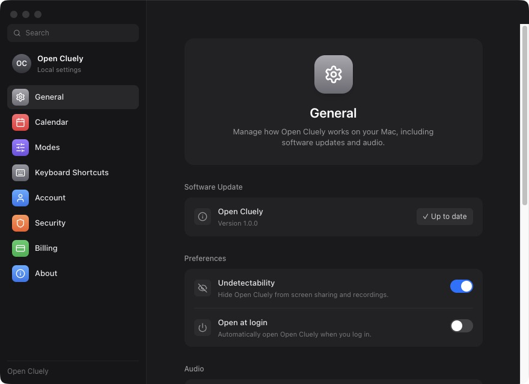
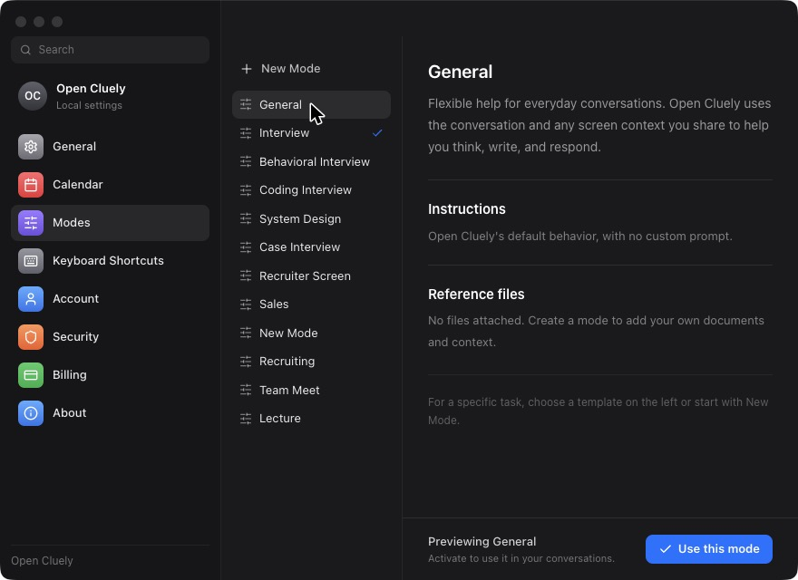

<div align="center">
  
  <h1>Open Cluely</h1>
  <p><strong>A free, open-source AI assistant that floats on top of your screen.</strong></p>
  <p>Ask it anything, let it see what's on your screen, and get answers — during meetings, interviews, studying, or writing. Bring your own AI key, or run it fully offline.</p>

  <a href="https://github.com/aikay-source/open-cluely/releases/latest"><strong>⬇️ Download the latest version</strong></a>
</div>

---

## What is Open Cluely?

Open Cluely is a small window that sits quietly on top of everything else on your computer. You type a question, and it answers. You can also let it **look at your screen** or **listen to audio** so its answers fit whatever you're doing right then — a question on a call, a problem on a coding screen, a slide you're presenting.

A few things that make it useful:

- **It's always there, but out of the way.** The assistant floats above your other apps and you can click straight through it to whatever is behind it.
- **It can use your screen as context.** Turn on "Use screen as context" and it reads what's visible to give a relevant answer — no copy-pasting.
- **It stays hidden from screen sharing.** With Undetectability on, Open Cluely doesn't show up in screen-share or recordings.
- **You bring your own AI.** Use a cloud provider with your own API key (OpenAI, OpenRouter, Google Gemini, Groq, DeepSeek, Mistral, Together) — or run a local model with [Ollama](https://ollama.com) for a fully private, offline setup. Your key stays on your machine.
- **Modes tailor the answers.** Switch between presets like Interview, Coding Interview, or Sales, each with its own instructions and reference files.

---

## Download

Grab the right file for your computer from the **[latest release](https://github.com/aikay-source/open-cluely/releases/latest)**:

| Your computer | Download |
|---------------|----------|
| **Mac** (Apple Silicon — M1/M2/M3/M4) | [`Open-Cluely-1.0.5-arm64.dmg`](https://github.com/aikay-source/open-cluely/releases/download/v1.0.5/Open-Cluely-1.0.5-arm64.dmg) |
| **Windows** | [`Open-Cluely-Setup-1.0.5.exe`](https://github.com/aikay-source/open-cluely/releases/download/v1.0.5/Open-Cluely-Setup-1.0.5.exe) |

> The app isn't signed with a paid developer certificate yet, so your computer will show a one-time "unknown developer" warning the first time you open it. The install steps below show how to get past it. It's safe — the warning just means we haven't paid Apple/Microsoft for a signing certificate.

---

## Install on Mac

1. Download the **`.dmg`** file above.
2. Double-click it, then drag **Open Cluely** into your **Applications** folder.
3. The first time you open it, macOS blocks unsigned apps. To get past it: open your **Applications** folder, **right-click** (or Control-click) **Open Cluely**, and choose **Open**. Click **Open** again in the dialog. You only need to do this once.
4. If you want it to read your screen, grant permission: **System Settings → Privacy & Security → Screen Recording**, and turn on **Open Cluely**. Quit and reopen the app after granting it.

> Apple Silicon only for now (M1 and newer). Intel Macs aren't supported by the current build.

## Install on Windows

1. Download the **installer** (`Open-Cluely-Setup-...exe`) above.
2. Run the file. Windows SmartScreen may show a blue "Windows protected your PC" box — click **More info**, then **Run anyway**. (One-time, for the same unsigned-app reason.)
3. The installer walks you through setup.

---

## How to use it

### 1. Connect your AI

Open Cluely needs an AI brain to answer. Open **Settings → AI Model** and either:

- **Cloud:** pick a provider, paste your **API key**, choose a model, and click **Save**. (Get a key from your provider — e.g. [OpenAI](https://platform.openai.com/api-keys), [OpenRouter](https://openrouter.ai/keys), or [Google AI Studio](https://aistudio.google.com/apikey).)
- **Local:** install [Ollama](https://ollama.com), then choose **Local** and pick a model you've pulled. Nothing leaves your computer.

Your API key is stored only on your own machine and is sent only to the provider you chose.

### 2. Ask a question

Click **Ask**, type your question, and press **Send** (or `Cmd/Ctrl + Enter`). The answer appears right in the floating panel.

### 3. Let it see or hear

- Turn on **Use screen as context** so it answers based on what's on your screen.
- Use **Listen** to bring in audio (great for calls and interviews).
- Pick a **Mode** to shape the tone and focus of the answers.

### Keyboard shortcuts

On Windows use `Ctrl`, on Mac use `Cmd`.

| Shortcut | What it does |
|----------|--------------|
| `Cmd/Ctrl + B` | Show or hide the assistant |
| `Cmd/Ctrl + Shift + Space` | Bring it to the center and show it |
| `Cmd/Ctrl + Enter` | Send / ask with the current screen |
| `Cmd/Ctrl + R` | Clear and start fresh |
| `Cmd/Ctrl + Arrow keys` | Move the window around the screen |

---

## Screenshots

**Settings — General**



**Modes — tailor the assistant for different situations**



---

## Privacy

- Your AI **API key is stored locally** on your computer and is never sent anywhere except directly to the AI provider you pick.
- Choose **local (Ollama)** mode to keep everything on your machine with no cloud calls at all.
- **Undetectability** keeps the window out of screen-share and recordings.

---

## Build from source

Prefer to run it yourself from the code? You'll need [Node.js](https://nodejs.org) and Git.

```bash
git clone https://github.com/aikay-source/open-cluely.git
cd open-cluely
npm install
```

If you hit a Sharp/native build error during install:

```bash
SHARP_IGNORE_GLOBAL_LIBVIPS=1 npm install --ignore-scripts
npm rebuild sharp
```

You can set a default provider with a `.env` file in the project root (optional — you can also do this in-app under Settings → AI Model):

```env
# Cloud (Gemini)
GEMINI_API_KEY=your_api_key_here

# Or OpenAI-compatible (OpenAI, OpenRouter, Groq, ...)
OPENAI_API_KEY=your_api_key_here
OPENAI_BASE_URL=https://api.openai.com/v1
OPENAI_MODEL=gpt-4o-mini

# Or local Ollama
USE_OLLAMA=true
OLLAMA_MODEL=llama3.2
```

Then run it in development, or build your own installer:

```bash
npm start          # run in development
npm run app:build  # build a packaged app for your OS
```

---

## Credits

Open Cluely is an open-source take on the invisible-assistant idea, forked and reworked from [Prat011/free-cluely](https://github.com/Prat011/free-cluely). Built with Electron, React, and TypeScript.
